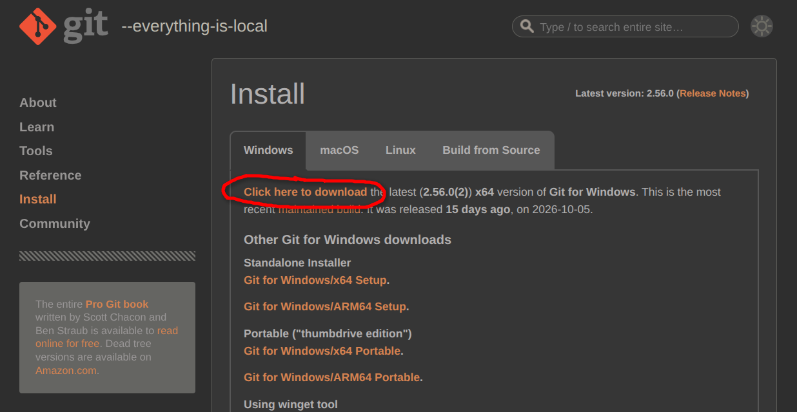
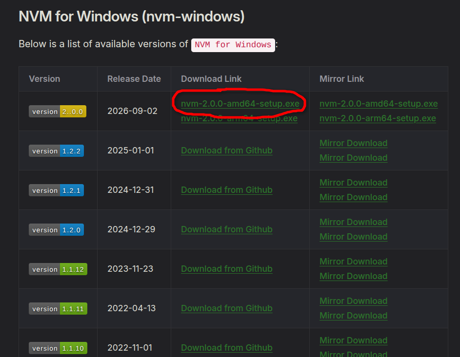

# Windows Setup Guide

Updated October 23, 2026

Install your tools, set up the Paiflow starter, then use Engr with Kimi to build your app. Follow the steps in order on Windows 10 or 11 with internet access and permission to install software. Use **Git Bash for every terminal command** in this guide.

## Install Git for Windows

**Check first:** search Start for **Git Bash**. If it is available, open it and run:

```bash
git --version
```

If a Git version appears, skip the Git installer and continue to **Install Node with NVM**. If Git Bash is unavailable or the command is not found, install Git below.

Open [Git for Windows](https://git-scm.com/install/windows). For a typical x64 Windows laptop, click **“Click here to download”**, circled below. If your laptop uses ARM64, choose **Git for Windows/ARM64 Setup** instead.



1. Download the installer for your computer using the link above.
2. Run it. Keep **Git from the command line and also from 3rd-party software** selected when asked about PATH. Keep the other defaults.
3. Open **Git Bash** from the Start menu and check:

```bash
git --version
```

You should see a Git version number. Keep using Git Bash for the remaining steps. Paste commands with **Shift+Insert** or right-click → **Paste**.

## Install Node with NVM

NVM lets you install and select Node.js. This guide uses Node.js 22.22.2.

**Check first:** in Git Bash, run:

```bash
node --version
npm --version
nvm version
```

If Node is **22.22.2 or a newer 22.x version** and npm prints a version, skip this section. If you need Node and `nvm version` prints a version, skip the NVM installer and run the Node commands below. If neither is ready, install NVM below.

Open the [NVM download page](https://www.nvmnode.com/guide/download.html). For an x64 Windows laptop, use **nvm-2.0.0-amd64-setup.exe**, circled below. For ARM64, select the corresponding **arm64** installer.



1. If you already use NVM for Windows, skip its installer. If you installed Node.js separately, follow the [NVM migration instructions](https://github.com/nvm-windows/nvm#installation--upgrades) first to avoid conflicting installations.
2. Download the installer for your computer from the page above. Run it with the default settings.
3. Close your terminals and open a new **Git Bash** window. Run:

```bash
nvm version
nvm install 22.22.2
nvm use 22.22.2
node --version
npm --version
```

**Checkpoint:** Node prints `v22.22.2`, and npm prints a version number. Use Node `22.22.2` or a newer 22.x version for this setup.

## Install pnpm

**Check first:** run `pnpm --version` in Git Bash. If it prints **10.4.1**, skip installation and continue to **Run the Paiflow starter**. Otherwise, install the required version:

```bash
npm install --global pnpm@10.4.1
pnpm --version
```

Check that `10.4.1` appears. If `pnpm --version` returns a command-not-found error, paste this into Git Bash, then reload your settings and check again:

```bash
echo 'export PATH="$(cygpath -u "$(npm config get prefix)"):$PATH"' >> ~/.bashrc
source ~/.bashrc
pnpm --version
```

Continue in this terminal to set up the starter.

## Run the Paiflow starter

The starter requires Node `>=22.22.2 <23` and pnpm **10.4.1**.

Create a projects folder in your Windows user directory, then clone the [Paiflow starter](https://github.com/artisam-paiflow/paiflow-hackathon-starter):

### First-time setup

```bash
mkdir -p ~/projects
cd ~/projects
```

**Before running:** paste only the clone command below, check that the URL starts with `https://` (two slashes, no spaces), then press **Enter**. Correct any missing slash or added space first.

```bash
git clone https://github.com/artisam-paiflow/paiflow-hackathon-starter.git
```

After cloning succeeds, remove the starter's Git history and remote so you can create your own repository. This keeps the app files. Run this only for a fresh clone:

```bash
cd ~/projects/paiflow-hackathon-starter && rm -rf -- .git
```

Then install and start the app. You can run `git init` later to track your own project:

```bash
pnpm install --frozen-lockfile
cp .env.example .env.local
pnpm dev
```

### Check the app

In your browser, open [http://localhost:3000](http://localhost:3000). If the terminal reports a different port, open the address it prints.

**Checkpoint:** the starter page loads. Payment actions remain disabled until you configure a deployment and API token; this is expected. You can start customising the app without those credentials.

After checking the page, return to Git Bash and press **Ctrl+C** to stop the app. Wait for the command prompt to return, then continue with Engr setup in the same terminal. You can close the browser tab.

## Set up Engr with Kimi

[Engr](https://github.com/kimerran/engr) runs Claude Code with your chosen AI provider. Use it with your Kimi API key. Continue in the same Git Bash terminal after stopping the starter.

### Install Claude Code

**Check first:** in Git Bash, run `claude --version`. If a version appears, skip Claude Code installation and continue to **Install Engr**. Otherwise, run the [Windows installation command](https://code.claude.com/docs/en/setup):

```bash
winget install Anthropic.ClaudeCode
```

If installation fails, use this instead:

```bash
winget install --id Anthropic.ClaudeCode --exact --source winget
```

After installation, close that window and open a new **Git Bash** window so it picks up the updated PATH. Check with `claude --version`.

### Install Engr

**Check first:** run `engr --help`. If Engr's help appears, skip installation and continue to **Use Engr with Kimi**. If it is not found, try `source ~/.bashrc` and check again before installing.

Keep Engr outside your app folder. The commands below download it to `~/engr` in your home directory and install the command in `~/.local/bin`. If `~/engr` already contains your Engr checkout, skip the clone command and use that copy.

```bash
cd ~
```

**Before running:** paste only the clone command below, check that the URL starts with `https://` (two slashes, no spaces), then press **Enter**. Correct any missing slash or added space first.

```bash
git -c core.autocrlf=false clone https://github.com/kimerran/engr.git ~/engr
```

After cloning succeeds (or if you already have the Engr checkout), run:

```bash
bash ~/engr/install
echo 'export PATH="$HOME/.local/bin:$PATH"' >> ~/.bashrc
source ~/.bashrc
engr --help
```

Engr is now available for any project. Return to your app folder when you start coding, as shown below.

## Use Engr with Kimi

**Check first:** paste the entire block below into **Git Bash**, then press **Enter**. It loads your settings and checks whether a key is already configured without displaying it:

```bash
[ ! -f ~/.bashrc ] || source ~/.bashrc
if [ -n "$ENGR_KIMI_API_KEY" ]; then
  export ENGR_KIMI_API_KEY
  echo "Key configured; try engr --kimi"
else
  echo "Key not set"
fi
```

If **Key configured** appears, skip saving the key and go to the `engr --kimi` command below. Starting Engr checks whether the key works.

Run this once to save your Kimi API key in `.bashrc`. Paste the entire block below into **Git Bash**, then press **Enter**. When **Kimi API key:** appears, paste only your key and press **Enter** again. The key stays hidden and out of command history:

```bash
{
  read -r -s -p "Kimi API key: " ENGR_KIMI_API_KEY
  echo
  if [ -n "$ENGR_KIMI_API_KEY" ]; then
    printf '\nexport ENGR_KIMI_API_KEY=%q\n' "$ENGR_KIMI_API_KEY" >> ~/.bashrc &&
      export ENGR_KIMI_API_KEY
  else
    echo "No key entered; nothing saved"
  fi
}
```

The key is stored as plain text in `.bashrc`; keep that file private. Empty input saves nothing; try the prompt again. Saving again appends another entry; the last entry wins.

## Start coding

In Git Bash, open the starter folder and launch Engr. If your starter is in a different location, replace the path below with its actual path:

```bash
cd ~/projects/paiflow-hackathon-starter && engr --kimi
```

Engr starts only if the folder opens successfully.

When you want to preview the app, open another Git Bash terminal in the starter folder and run `pnpm dev`. Stop it with **Ctrl+C** when finished. In a new Git Bash session, run `source ~/.bashrc` before starting Engr. Keep the key out of project files, screenshots and chat prompts. Review Engr's requested actions.

Try: **“Read README.md and AGENTS.md. Explain this starter, then help me build my hackathon idea.”**

## Fix common setup problems

| Problem                                    | What to do                                                                                                                                             |
| ------------------------------------------ | ------------------------------------------------------------------------------------------------------------------------------------------------------ |
| Git, NVM or Node is not recognised         | Close and reopen your terminal. If using an editor terminal, restart the editor too. Check that its installer finished.                                |
| Node shows the wrong version               | In Git Bash, run `nvm use 22.22.2`. If it still differs, run `nvm debug` and check the NVM migration instructions in the NVM section.                  |
| npm or pnpm says scripts are disabled      | Open Git Bash from Start and run the commands there, as shown in the pnpm section.                                                                     |
| Dependency installation fails              | Check your internet connection, `node --version` and `pnpm --version`. Keep the lockfile; ask a mentor about the exact error.                          |
| winget is not recognised                   | Install or update Microsoft's [App Installer](https://learn.microsoft.com/en-us/windows/package-manager/winget/#install-winget), then reopen Git Bash. |
| claude or engr is not found in Git Bash    | Reopen Git Bash after installation. For Engr, run `source ~/.bashrc` and check that the source installer finished.                                     |
| Kimi rejects the key                       | Check that your Kimi key is active. Re-enter it using the hidden prompt.                                                                               |
| Git says the starter folder already exists | Open your existing project folder and continue there. Do not clone into it again.                                                                      |
| Port 3000 is busy                          | Open the local address printed by the dev server, or stop your earlier server with Ctrl+C.                                                             |

### Ready to build

- Git prints a version number.
- Node prints `v22.22.2` or a newer 22.x version; pnpm prints `10.4.1`.
- The Paiflow starter loads in your browser; payment actions stay disabled until configured.
- `claude --version` and `engr --help` work in Git Bash.
- Engr opens with `engr --kimi` from your project folder.

### Keep these links handy

- [Starter README](https://github.com/artisam-paiflow/paiflow-hackathon-starter#readme) and [Engr instructions](https://github.com/kimerran/engr#readme)
- [NVM for Windows](https://github.com/nvm-windows/nvm#readme), [pnpm installation](https://pnpm.io/10.x/installation) and [Claude Code setup](https://code.claude.com/docs/en/setup)
- [Paiflow Guide](paiflow-guide.md) for deployment and integration after starter setup
